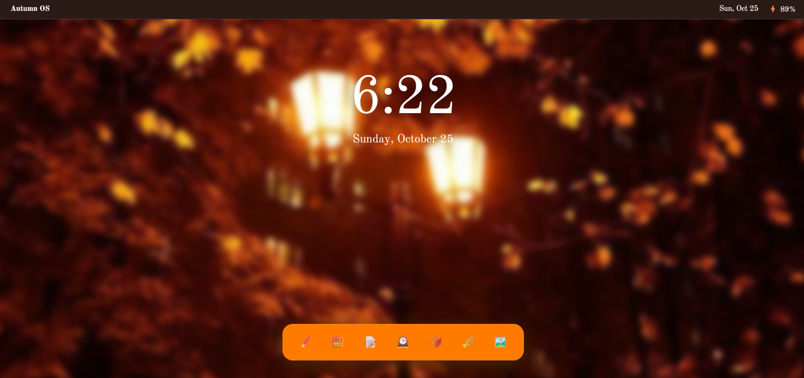

🍂AutumnOS

A cozy Autumn-themed desktop in your web browser with cute gifs and simple mini-apps.

Try it Out!
----
https://gigiop817.github.io/Sweaterweather_WebOS/

Quickstart
----

Click the link

Features
-----
- Cozy Welcome Screen + The ability to switch wallpapers using the Gallery App
- Live Clock, Date, and Battery Display
- Interactive App Dock with a variety of apps

Apps:
 Calculator, Paint, Notepad, Timer, Bucket-list, Music Player, and Gallery.

 How It Works
 ---------------
 Autumn OS is built using vanilla HTML, CSS, and JavaScript to keep the enire desktop environment lightweight and responsive. The mini-apps leverage brower native features like the HTML5 Canvas API for real-time drawing in Paint and reactive input event listeners for instant Timer updates. 

 Credits
 ----------
 - Custom Fonts provided by Google Fonts
 - Wallpapers, Images, and GIFs curated via Pinterest
 - Native system emojis used for dock icons and window interface details